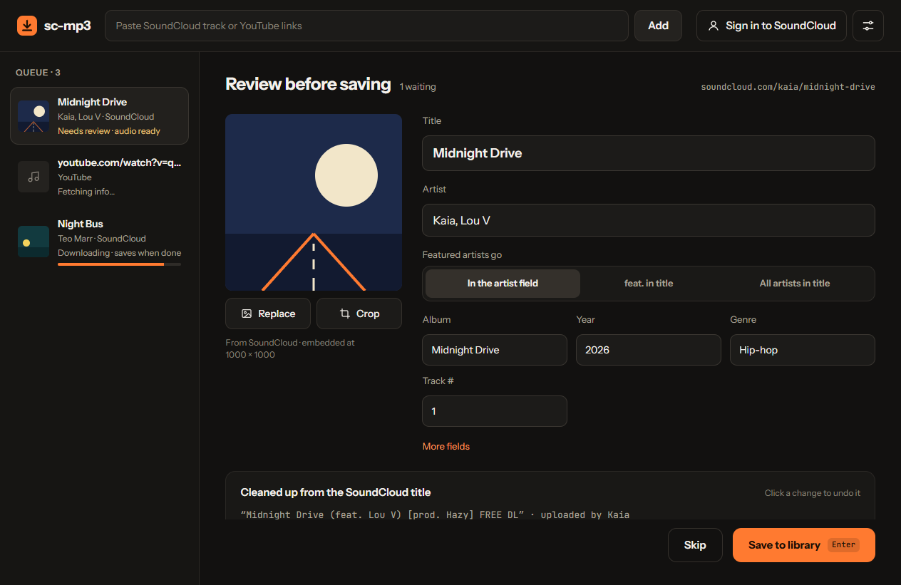

# sc-mp3

sc-mp3 saves songs from SoundCloud and YouTube as MP3 files that Spotify can play as local files. You paste a link, check the title, artist and cover it suggests, and save. The songs go into a folder on your computer, which you add to Spotify once.

Version 0.1 is for 64-bit Windows.



## Install

1. Download `sc-mp3-<version>-windows-x64.zip` from the [latest release](../../releases/latest). It's about 66 MB.
2. Extract the zip: right-click it, choose Extract All, then Extract. sc-mp3 doesn't run from inside the zip. Extracted, it takes about 155 MB.
3. Open the extracted `sc-mp3` folder and double-click `sc-mp3.exe`.

sc-mp3 isn't signed, so the first time you open it Windows shows "Windows protected your PC". Select More info, then Run anyway.

If Smart App Control is on, Windows blocks sc-mp3 with no option to run it. Smart App Control can't make an exception for one app. You can turn it off in Windows Security › App & browser control › Smart App Control settings. On some versions of Windows you can't turn it back on without reinstalling Windows, so decide before you do.

If sc-mp3 says it needs WebView2, select Yes to open Microsoft's download page, install it, then open sc-mp3 again.

To update, quit sc-mp3, download the new zip, extract it, and replace the old `sc-mp3` folder with the new one. Your songs, settings and queue stay, since sc-mp3 keeps them outside that folder.

## First run

Setup has four steps:

1. Where your songs go. The default is Music › sc-mp3, and each artist gets a folder inside it.
2. How titles look. Pick where featured artists go. You can change this later.
3. SoundCloud account. Select Skip for now.
4. Add the folder to Spotify. In Spotify on your computer, select your profile picture at the top right, then Settings. Under Your Library, turn on Show Local Files. Choose Add a source and pick the sc-mp3 folder. Your songs appear under Local Files in Your Library. Then select Finish in sc-mp3.

## Save a song

Copy a SoundCloud, YouTube or YouTube Music link, then press Ctrl+V in the sc-mp3 window, or paste it into the box at the top and select Add. sc-mp3 suggests a title, artist and cover. Fix anything that's wrong, then select Save to library or press Enter.

You can paste several links at once, then select Save all. Your first YouTube link asks to add YouTube support, about 40 MB, downloaded once. Select Download it.

A SoundCloud album or playlist link becomes one item in the queue, with a row for each track. A set that SoundCloud marks as an album, EP or single saves as an album, with one cover, the album name and track numbers. Other sets, such as playlists, save as separate songs. You can switch between the two, leave tracks out, and fix titles and artists in the table before you save.

## Fix the tags of songs you already have

Drop MP3 or M4A files on the sc-mp3 window, or select Open audio files when the queue is empty. The same editor opens with the file's own title, artist and cover, cleaned up the same way, and nothing is downloaded. Select Save changes to the file, and sc-mp3 writes the new tags into it where it is. If you change the title, artist or album of a song that's in a Spotify playlist, Spotify treats it as a different song, so add it to the playlist again. If Spotify keeps showing the old tags, see the next sections.
## Songs on your phone

Spotify on a phone plays MP3 files stored on the phone itself. You don't need Premium.

1. In Spotify on the phone, go to Settings and privacy › Apps and devices and turn on Local audio files.
2. Copy the MP3 files to the phone.
   - iPhone: copy them into Files › On My iPhone › Spotify. From a Windows PC, connect the iPhone and use file sharing in the Apple Devices app or iTunes. Copy the song files themselves, not the artist folders they're in.
   - Android: copy them into the phone's storage, for example the Music folder, over USB.

## Spotify isn't showing my changes

Spotify keeps its own list of local files and can be slow to notice new or edited songs. Try these in order:

1. In Spotify's settings, turn Show Local Files off, then on again.
2. Remove the sc-mp3 folder from Spotify's sources, then add it again.
3. Quit Spotify, delete the file `local-files.bnk`, then open Spotify again. To find the file, select the settings button at the top right of sc-mp3, then Spotify help › Songs not showing up › Open the folder with local-files.bnk.

## License

sc-mp3 is for personal use. Respect the artists and the terms of each service you download from. Tracks protected by DRM can't be saved.

sc-mp3 is licensed under GPL-3.0-or-later. See [LICENSE](LICENSE) and [THIRD_PARTY_NOTICES.md](THIRD_PARTY_NOTICES.md).

## Developer setup

You need [uv](https://docs.astral.sh/uv/). It downloads Python 3.13 if you don't have it.

```
uv sync
uv run pytest
uv run python packaging/build.py
```

Some tests need ffmpeg. They skip when ffmpeg isn't on your PATH. `packaging/build.py` builds the Windows zip into `dist/`.
